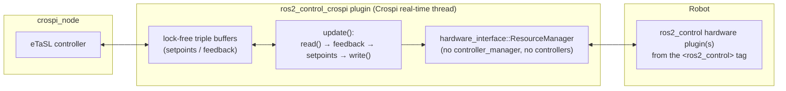

# ros2_control_crospi Package

Generic [Crospi](https://rob.pages.gitlab.kuleuven.be/crospi/) robot driver plugin that interfaces **any robot that has a
[ros2_control](https://control.ros.org) hardware interface** (UR, Franka, KUKA, Kinova, Dynamixel, ...,
`mock_components/GenericSystem`, `topic_based_ros2_control` for Isaac Sim, ...). You don't need to write and
maintain a Crospi driver for every robot brand. Instead, you configure in the setup JSON which robot description
(URDF/xacro with its `<ros2_control>` tag) to use, and the driver loads the hardware plugins declared in it.

## How it works



- The robot description is loaded in a `hardware_interface::ResourceManager`, which loads, configures and activates the
  hardware components (ros2_control hardware interface plugins) of its `<ros2_control>` tags.
- There is **no controller_manager and there are no controllers**. Every `periodicity` seconds, Crospi's real-time
  driver thread calls `update()`, which runs one ros2_control cycle directly:
  `read()` of the hardware → feedback written to Crospi's triple buffers → joint velocity setpoints read from Crospi →
  commands set → `write()` of the hardware.
- Crospi's lock-free triple buffers are still used between the eTaSL controller and the driver. ros2_control is only
  used as the hardware abstraction layer, so no mutex-based `realtime_tools` buffers or extra controller layer is
  added to the control path.
- The joint velocity setpoints of Crospi are sent to the **velocity** command interfaces of the joints, or integrated
  into **position** commands (`command_interface`).
- Before the interfaces are claimed, the hardware is asked to switch its control mode
  (`prepare/perform_command_mode_switch`), just as the controller_manager does when a controller is activated
  (e.g. this switches a UR to its velocity mode).
- The plugin is registered both as a **robotdriver** (`simulation:=false`) and as a **robotsimulator**
  (`simulation:=true`), so it can also be used with simulated ros2_control hardware.

## Installation

### Dependencies

The driver needs the ros2_control hardware interface library and xacro. The UR10e quick start below also uses the
mock UR description of `ur_description`:

```bash
sudo apt update
sudo apt install ros-$ROS_DISTRO-hardware-interface ros-$ROS_DISTRO-xacro ros-$ROS_DISTRO-ur-description
```

`ros-$ROS_DISTRO-hardware-interface` also provides `mock_components/GenericSystem`, the mock hardware used in the
quick start. Alternatively, `rosdep` installs everything declared in [package.xml](package.xml):

```bash
cd <crospi_ws>
rosdep install --from-paths src --ignore-src -y
```

### Build

Clone this package in the `src` folder of your Crospi workspace and build it:

```bash
cd <crospi_ws>
colcon build --symlink-install --packages-select ros2_control_crospi
source install/setup.bash

# Rebuild your application template package: this scans for new plugins and regenerates the JSON schemas
# of the setup configuration (autocompletion of the parameters below).
colcon build --symlink-install --packages-select <your_crospi_application_template_package>
source install/setup.bash
```

You also need the package that provides the hardware plugin of your robot, e.g. `ur_robot_driver` for UR robots
(`sudo apt install ros-$ROS_DISTRO-ur-robot-driver`). Supported ROS 2 distributions: Jazzy and newer; it has been tested
on Kilted.

## Quick start (UR10e mock hardware, no robot needed)

[config/ur10e_mock_hardware.setup.json](config/ur10e_mock_hardware.setup.json) is a complete Crospi setup
that uses the UR10e description of `ur_description` with `mock_components/GenericSystem`. Its velocity commands are
integrated by the mock hardware, which also exposes the `tcp_fts_sensor` force-torque sensor.

```bash
# The plugin alone: loads it through pluginlib (as crospi_node does) and drives all joints with a sinusoidal velocity.
ros2 run ros2_control_crospi test_ros2_control_crospi \
  --config '$[ros2_control_crospi]/config/ur10e_mock_hardware.setup.json' --list robotsimulators --index 0 \
  --duration 4 --amplitude 0.5 --frequency 0.25 --real-time true --csv none

# The full crospi_node (simulation:=true uses robotsimulators, simulation:=false uses robotdrivers)
ros2 run crospi_core crospi_node --ros-args -p config_file:="\$[ros2_control_crospi]/config/ur10e_mock_hardware.setup.json" -p simulation:=true
```

## Configuration

Add an entry to `robotdrivers` (or `robotsimulators`) in the `robot` field of your setup JSON. The complete reference,
used for autocompletion, is the JSON schema
[json_schemas/ros2_control_crospi.schema.json](json_schemas/ros2_control_crospi.schema.json).

| Parameter | Required | Description |
|-----------|----------|-------------|
| `is-ros2_control_crospi` | yes | `true`: selects this driver. |
| `robot_joints` | yes | Joints controlled by this driver (as in the URDF of the robot specification). |
| `periodicity` | yes | Period [s] of the read/write cycle (e.g. `0.002` for UR e-series, `0.001` for Franka). |
| `robot_description_path` | yes | URDF or `.xacro` file with the `<ros2_control>` tag. Supports `$[package]`, `${ENV}`, `package://` and `file://`. |
| `command_interface` | yes | `velocity` (setpoints sent directly) or `position` (setpoints integrated from the measured initial position). |
| `xacro_arguments` | no | Object with the `name:=value` arguments of xacro, e.g. `{"ur_type": "ur10e", "robot_ip": "192.168.1.102"}`. |
| `hardware_joints` | no | Joint names in the `<ros2_control>` tag if they differ from `robot_joints` (e.g. with a `tf_prefix`). |
| `hardware_components` | no | Hardware components (`<ros2_control name="...">`) to activate. Default: all. |
| `initialization_timeout` | no | Time [s] to wait for valid joint positions after activation. Default: `5.0`. |
| `ros_node_name` | no | Name of the ROS 2 node of the driver (clock, logging, nodes of the hardware components). Default: `ros2_control_crospi`. Use different names for several drivers. |
| `force_torque_sensor_name` | no | Sensor with `<name>/force.x ... torque.z` state interfaces (e.g. `tcp_fts_sensor` for UR). |
| `pose_sensor_name` | no | Sensor with `<name>/position.x ... orientation.w` state interfaces (e.g. `tcp_pose` for UR). |
| `name_expr_joint_vel` | no | Reports the `velocity` state interfaces of the joints to eTaSL. |
| `name_expr_joint_torque` | no | Reports the `effort` state interfaces of the joints to eTaSL. |
| `name_expr_cartesian_pos` / `name_expr_cartesian_quat` | no | Report the pose sensor (requires `pose_sensor_name`). |
| `name_expr_cartesian_wrench` | no | Reports the force-torque sensor (requires `force_torque_sensor_name`). |

Joint positions are always reported (`position` state interfaces). If a requested interface does not exist in the
hardware, the initialization fails with a message that lists the available interfaces.

### Example: real UR e-series robot (`ur_robot_driver`)

The robot must run the *External Control* URCap program (see the
[ur_robot_driver documentation](https://docs.universal-robots.com/Universal_Robots_ROS2_Documentation/)).
Its `URPositionHardwareInterface` switches to velocity control when the velocity interfaces are claimed.

```json
"robotdrivers": [
    {
        "is-ros2_control_crospi": true,
        "robot_joints": ["shoulder_pan_joint", "shoulder_lift_joint", "elbow_joint", "wrist_1_joint", "wrist_2_joint", "wrist_3_joint"],
        "periodicity": 0.002,
        "robot_description_path": "$[ur_robot_driver]/urdf/ur.urdf.xacro",
        "xacro_arguments": {
            "name": "ur",
            "ur_type": "ur10e",
            "robot_ip": "192.168.1.102",
            "script_filename": "$[ur_client_library]/resources/external_control.urscript",
            "input_recipe_filename": "$[ur_robot_driver]/resources/rtde_input_recipe.txt",
            "output_recipe_filename": "$[ur_robot_driver]/resources/rtde_output_recipe.txt"
        },
        "command_interface": "velocity",
        "hardware_components": ["ur"],
        "force_torque_sensor_name": "tcp_fts_sensor",
        "pose_sensor_name": "tcp_pose",
        "name_expr_joint_vel": "joint_vel",
        "name_expr_cartesian_wrench": "wrench_input"
    }
]
```

### Example: Isaac Sim (`topic_based_ros2_control`)

Use a robot description whose `<ros2_control>` tag uses the
[topic_based_ros2_control](https://github.com/PickNikRobotics/topic_based_ros2_control) plugin (it exchanges the joint
commands and states with Isaac Sim through ROS 2 topics), and add the driver to `robotsimulators`:

```xml
<ros2_control name="isaac" type="system">
  <hardware>
    <plugin>topic_based_ros2_control/TopicBasedSystem</plugin>
    <param name="joint_commands_topic">/isaac_joint_commands</param>
    <param name="joint_states_topic">/isaac_joint_states</param>
  </hardware>
  <joint name="shoulder_pan_joint">
    <command_interface name="velocity"/>
    <state_interface name="position"/>
    <state_interface name="velocity"/>
  </joint>
  <!-- ... the other joints ... -->
</ros2_control>
```

## Things to know

- **Do not run a controller_manager for the same hardware at the same time**: this driver owns the hardware.
  Joint states are published by Crospi's output handlers (e.g. `JointStateOutputHandler`).
- ros2_control **controllers and broadcasters are not executed**. Hardware features that are only reachable through
  controllers or GPIO command interfaces (e.g. UR's `resend_robot_program`, grippers controlled by a controller) need
  to be handled separately.
- The `read()`/`write()` of the hardware run in Crospi's real-time thread. The real-time behavior therefore depends on
  the hardware plugin, in the same way as with the controller_manager.
- Joint limits are not enforced by the driver. Use joint limit constraints in your eTaSL task specification.
- If initialization fails (wrong robot description, unreachable robot, missing interface, ...), the driver prints the
  reason and stops Crospi's control loop at its first update.
- On shutdown, the driver sends a standstill command (zero velocity, or the last position command), switches off the
  command interfaces and deactivates and shuts down the hardware components.

## Documentation

For documentation and tutorials, checkout our [crospi website](https://rob.pages.gitlab.kuleuven.be/crospi/), in
particular the [robot drivers tutorial](https://rob.pages.gitlab.kuleuven.be/crospi/markdown/advanced_tutorials/robot_drivers/).


## License and acknowledgements

Published under the [GNU LESSER GENERAL PUBLIC LICENSE](LICENSE) Version 3, 29 June 2007.


<a href="https://aiprism.eu/"></a>
This work was funded by the European Union’s Horizon 2020 research and innovation program 
under the grant agreement No. <a href="https://cordis.europa.eu/project/id/101058589">101058589</a> ( <a href="https://aiprism.eu/">AI-Prism</a>) 

<p/>

<p/>

<p/>

## Authors
<p float="left">
<a href="https://www.kuleuven.be/english/kuleuven/">
    
</a>
<a href="https://www.mech.kuleuven.be/en/research/ram">
    
</a>
</p>

(c) 2025, KU Leuven, Department of Mechanical Engineering, ROB-Group:

- [Santiago Iregui Rincon](https://www.kuleuven.be/wieiswie/en/person/00125886)
